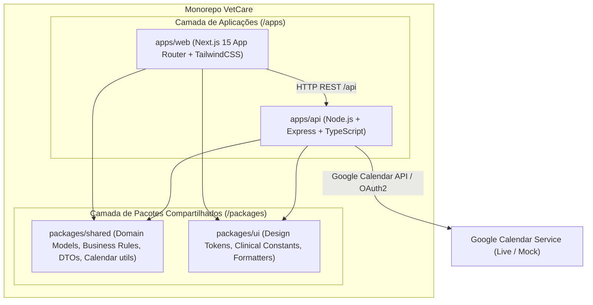
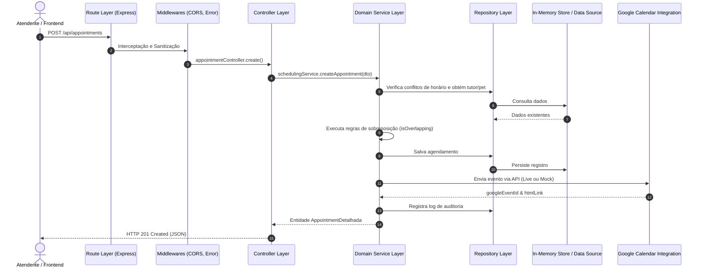
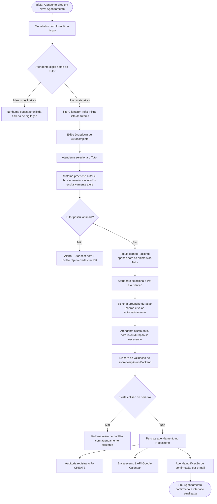
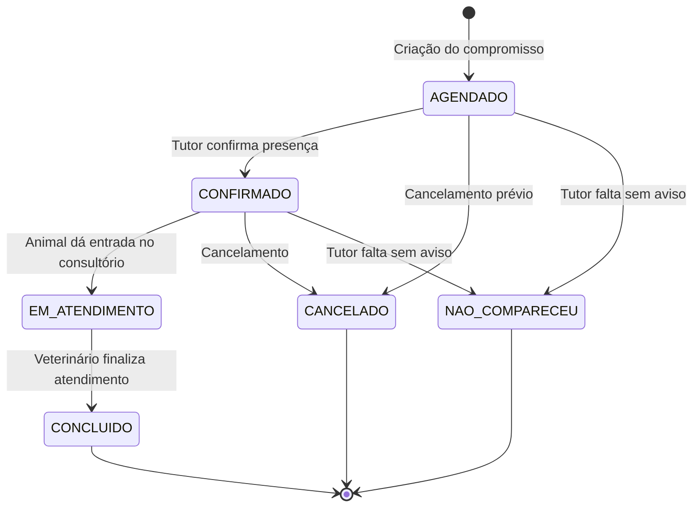

# 📘 Documentação Arquitetural Completa — VetCare (MedPet)

> **Versão do Sistema:** 2.0.0 (Modular Monorepo)  
> **Classificação:** Documentação Técnica de Arquitetura e Engenharia de Software  
> **Padrão Arquitetural:** MVC (Model-View-Controller) & Clean Architecture Modular  
> **Ambiente:** Monorepo gerenciado por Turborepo e npm workspaces  

---

## 1. Visão Geral Executiva

O **VetCare** (sistema interno MedPet) é uma plataforma web para gestão clínica, operacional, controle de estoque e agendamento veterinário. O sistema foi desenvolvido com prioridade para estações de trabalho desktop e notebooks, garantindo ergonomia para atendentes e veterinários, alta responsividade e total conformidade com o padrão brasileiro de datas, horários e moeda.

### Objetivos Primordiais
1. **Centralização Operacional:** Eliminar o uso disperso de cadernos, planilhas e mensagens de texto, consolidando clientes, animais, catálogo de procedimentos e auditoria em uma base consistente.
2. **Agendamento Inteligente & Google Calendar:** Permitir o agendamento de consultas com checagem automática de sobreposição de horários e sincronização com o Google Agenda.
3. **Relacionamento Estrito Tutor-Paciente:** Garantir que animais pertençam com integridade referencial a seus respectivos tutores, impedindo vínculos incorretos.
4. **Resiliência e Desacoplamento (MVC):** Aplicação das regras de negócio puras em pacotes compartilhados, separando controladores, camada de persistência e interfaces visuais.

---

## 2. Topologia do Monorepo

O projeto está estruturado como um monorepo moderno baseado em **Turborepo** e **npm workspaces**, permitindo compartilhamento de código em tempo de compilação sem duplicação.



### Detalhamento dos Módulos

| Diretório | Responsabilidade | Tecnologias Principais |
| :--- | :--- | :--- |
| `apps/web` | Frontend SPA/SSR, interfaces de usuário, dashboards de agendamento e modais. | Next.js 15, React 19, Tailwind CSS, Phosphor Icons |
| `apps/api` | API RESTful com arquitetura MVC, serviços de domínio e endpoints. | Express, Node.js, TypeScript, Google APIs Client |
| `packages/shared` | Modelos de domínio, interfaces TypeScript, regras puras de validação, formatação e XML. | TypeScript |
| `packages/ui` | Tokens de design, mapeamentos de cores clínicas, constantes operacionais (CLINIC_HOURS). | TypeScript |
| `docs` | Documentação arquitetural, guias de implantação e especificações. | Markdown |
| `tests` | Suíte de testes unitários, testes de integração e testes E2E. | Vitest, Playwright |

---

## 3. Padrão Arquitetural MVC (Model-View-Controller)

O sistema implementa o padrão **MVC** de forma rigorosa e desacoplada em ambas as extremidades (Backend e Frontend).

### 3.1. Arquitetura MVC no Backend (`apps/api`)



#### Camadas do Backend:
1. **Model (Dados & Entidades):**
   - Entidades puras em `packages/shared/src/index.ts` (`Appointment`, `Client`, `Pet`, `ClinicService`, `AuditLogEntry`).
   - Repositórios em `apps/api/src/domain/repositories/` que gerenciam a coleção de dados e garantem integridade referencial.
   - `in-memory.store.ts` com semente de dados realistas (`data.seed.ts`) para testes e operação inicial de baixo custo.
2. **View (Representação dos Dados):**
   - Na API REST, a "View" corresponde aos DTOs de resposta (`AppointmentDetailedView`), gerador de XML estruturado (`generateAppointmentsXml`) e formatos padronizados de erro HTTP.
3. **Controller (Orquestração de Requisições):**
   - Localizados em `apps/api/src/controllers/` (`appointment.controller.ts`, `client.controller.ts`, `pet.controller.ts`, etc.).
   - Responsáveis por extrair parâmetros HTTP, invocar serviços de aplicação e formatar as respostas JSON com status codes adequados.

### 3.2. Arquitetura MVC no Frontend (`apps/web`)

No ecossistema React/Next.js moderno, o MVC é aplicado separando estado/comunicação (Model), fluxos de tela (Controller) e componentes de renderização (View):

```mermaid
graph LR
    subgraph Model ["Model (Camada de Dados & API)"]
        M1["services/*.service.ts"]
        M2["api.service.ts (HTTP Fetch wrapper)"]
        M3["packages/shared (Types, Rules & Calendar Utils)"]
    end

    subgraph Controller ["Controller (Lógica de Apresentação & Estado)"]
        C1["hooks/useAppointments.ts"]
        C2["hooks/useCalendarView.ts"]
        C3["hooks/useClients.ts"]
        C4["hooks/useScheduleForm.ts"]
        C5["hooks/useServiceCatalog.ts"]
    end

    subgraph View ["View (Componentes Visuais Puros)"]
        V1["components/layout (Header, Sidebar)"]
        V2["components/dashboard (CalendarGrid, AppointmentCard)"]
        V3["components/modals (NewAppointment, Detail, Tutor, Pet)"]
        V4["components/tabs (Dashboard, Clients, Completed, Reports)"]
    end

    Model --> Controller
    Controller --> View
    View -- "Interações do Usuário" --> Controller
    Controller -- "Chamadas de Ação" --> Model
```



- **Model:** Serviços em `apps/web/src/services/` abstraem o consumo de endpoints da API e tipos do `@vetcare/shared`.
- **Controller:** Hooks customizados em `apps/web/src/hooks/` isolam validações de formulário, manipulação de filtros e regras de autocomplete.
- **View:** Componentes em `apps/web/src/components/` que recebem propriedades e callbacks, mantendo zero acoplamento com o protocolo HTTP.

---

## 4. Módulo de Agendamento (Deep Dive)

### 4.1. Visualizações da Agenda e Algoritmo de Período

A visualização do calendário conta com adaptação dinâmica de colunas conforme o filtro acionado:

| Filtro | Descrição Técnica | Total de Colunas Geradas | Comportamento na Grade |
| :--- | :--- | :--- | :--- |
| **Hoje (`HOJE`)** | Retorna o dia corrente com hora zerada (`00:00:00`). | 1 dia + 1 coluna HORA (2 colunas) | Foco intensivo nos compromissos do dia. |
| **Esta Semana (`SEMANA`)** | Calcula o domingo anterior (`d.getDate() - d.getDay()`) e gera 7 dias consecutivos. | 7 dias + 1 coluna HORA (8 colunas) | Padrão estilo Google Calendar / VetPal com grade horária. |
| **Este Mês (`MES`)** | Obtém o dia 1 do mês e itera até o total de dias do mês (`new Date(y, m+1, 0).getDate()`). | 28 a 31 dias + 1 coluna HORA | Panorama completo dos dias do mês atual. |
| **Este Ano (`ANO`)** | Itera de 0 a 11 gerando o primeiro dia de cada mês do ano de referência. | 12 meses + 1 coluna HORA (13 colunas) | Visão executiva anual condensada. |

#### Otimização de Performance da Grade
A grade horária renderiza `CLINIC_HOURS` (08:00 às 18:30). Para evitar varreduras lineares repetitivas $O(D \times H \times N)$ a cada render, o sistema utiliza um **índice de acesso constante $O(1)$** indexado por `chave = "YYYY-MM-DD_H"`:

$$\text{appointmentsByDateHour} = \text{Map}\langle \text{date\_hour}, \text{AppointmentDetailedView}[] \rangle$$

### 4.2. Fluxo Completo de Criação de Agendamento



### 4.3. Regra Matemática de Não-Sobreposição de Horários

Dois agendamentos $A$ e $B$ colidem se, e somente se, houver intersecção temporal positiva entre seus intervalos abertos:

$$\text{isOverlapping}(A, B) \iff (\text{Start}_A < \text{End}_B) \land (\text{End}_A > \text{Start}_B)$$

O sistema ignora compromissos com situação `CANCELADO` e permite desconsiderar o próprio ID durante operações de reagendamento.

### 4.4. Máquina de Estados dos Agendamentos



Cada transição de estado registra imediatamente um evento imutável na tabela de Auditoria com autor, timestamp ISO e detalhes do procedimento.

---

## 5. Integrações Externas

### 5.1. Google Calendar Integration
- **Mecanismo:** A API utiliza a biblioteca oficial `googleapis` conectada via OAuth2 ou Service Account.
- **Modo Resiliente (Simulator / Mock):** Caso as credenciais não estejam presentes no `.env`, o sistema comuta automaticamente para o modo simulador, gerando links web válidos do Google Calendar (`https://calendar.google.com/calendar/r/eventedit?...`) sem interromper a rotina da clínica.
- **Sincronização:** Envio de resumo padronizado, descrição com tags para identificação do animal, tutor e ID do sistema interno.

### 5.2. Motor de Notificações por E-mail
- **Templates Dinâmicos:**
  1. *Confirmação de Agendamento:* Disparado no ato da marcação.
  2. *Lembrete Preventivo:* Notificação agendada para antecedência configurada.
  3. *Aviso de Alteração / Reagendamento:* Alerta imediato sobre nova data ou profissional.
  4. *Aviso de Cancelamento:* Liberação de horário e confirmação de cancelamento ao tutor.

### 5.3. Exportação Estruturada em XML
Para auditoria externa, backup ou relatórios regulatórios, o sistema dispõe do endpoint `/api/appointments/export/xml`, gerando um documento XML válido estruturado com data/hora em formato legível brasileiro e metadados completos de atendimento.

---

## 6. Design System e Padrões Brasileiros

O frontend respeita rigorosamente a localização brasileira:
- **Datas:** Exibidas em `DD/MM/AAAA` através da função pura `formatDateBR()`.
- **Horários:** Exibidos em `HH:mm` através de `formatTimeBR()`.
- **Valores Monetários:** Formatados em Real (`R$ 0,00`) através de `formatCurrencyBRL()`.
- **Cores por Categoria Clínica:**
  - `CIRURGIA`: Índigo (`border-l-indigo-500`, badges azul-violeta).
  - `VACINA`: Verde-azulado / Teal (`border-l-teal-400`).
  - `EMERGENCIA`: Rosa-escarlate (`border-l-rose-500`).
  - `CONSULTA / CHECKUP`: Esmeralda clássico (`border-l-emerald-400`).

---

## 7. Guia de Execução e Manutenção

### Pré-requisitos
- Node.js >= 18.0.0
- npm >= 9.0.0

### Instalação de Dependências
```bash
npm install
```

### Inicialização em Ambiente de Desenvolvimento
```bash
# Inicia todos os pacotes e aplicações concorrentemente via Turbo:
npm run dev

# Ou individualmente:
npm run dev --filter=@vetcare/api   # API em http://localhost:4000
npm run dev --filter=@vetcare/web   # Web em http://localhost:3000
```

### Execução de Testes Automatizados
```bash
# Executa testes unitários rápidos:
npm test

# Executa checagem de tipos estáticos TypeScript em todo o monorepo:
npm run typecheck

# Executa build de produção:
npm run build
```

---
*Documentação gerada e validada para a arquitetura do projeto VetCare / MedPet.*

